## Table of contents

1. [What this project does](#1-what-this-project-does)
2. [Architecture and data flow](#2-architecture-and-data-flow)
3. [Repository layout](#3-repository-layout)
4. [Prerequisites](#4-prerequisites)
5. [Setup, step by step](#5-setup-step-by-step)
6. [Running the pipeline](#6-running-the-pipeline)
7. [Configuration and conventions](#7-configuration-and-conventions)
8. [Macros reference](#8-macros-reference)
9. [Source data contract (Bronze)](#9-source-data-contract-bronze)
10. [Model catalogue](#10-model-catalogue)
11. [Output tables (Gold)](#11-output-tables-gold)
12. [How to make common changes](#12-how-to-make-common-changes)
13. [Troubleshooting](#14-troubleshooting)
14. [Orchestration notes](#15-orchestration-notes)
15. [Glossary](#16-glossary)

---

## 1. What this project does

This is a **dbt (data build tool) project** that runs on **PostgreSQL with PostGIS**. It implements a **medallion architecture** (Bronze → Silver → Gold) that builds a **parcel-centric property dataset** for one administrative area (sub-county) at a time. The default area is **Lang'ata**.

In plain terms:

1. It reads raw spatial and administrative layers from the `Bronze` schema: cadastral parcels, buildings, addresses, building permits, power (KPLC) customers, water (NWSC) meters, land rates and trade licences.
2. It **clips every layer to a single sub-county** boundary and cleans it (deduplication, active parcels only, primary addresses only).
3. It gives each cadastral parcel a **stable, deterministic UUID** (`uuid`) and a human-meaningful `property_ref`.
4. It **links** every point or polygon layer to the parcel it spatially intersects, so each feature gets the parcel `uuid`.
5. It **counts** how many addresses, buildings, permits, power meters and water meters fall on each parcel, and computes a 0–5 "fusion" score of how many of those five layers are present.
6. It **enriches** parcels with land-rate (billing) and trade-licence information.
7. It publishes four **Gold** tables for downstream use. The project is named `erits`. The `nlims` in several table names suggests an NLIMS (National Land Information Management System) consumer, but the repo does not say so explicitly.

Everything is SQL and Jinja. There is no Python application code in the repo.

### Project facts at a glance

| Item | Value |
|---|---|
| dbt project name / profile name | `erits` / `erits` |
| dbt project directory | `erits/` (a subfolder; **run dbt from inside it**) |
| dbt versions | `dbt-core==1.9.9`, `dbt-postgres==1.9.0` |
| Packages | `dbt-labs/dbt_utils` 1.3.1 |
| Target database | PostgreSQL + PostGIS |
| Schemas | `Bronze` (input), `Silver` (intermediate), `gold` (output). **Mixed case matters**, see [§7.3](#73-schema-naming-and-case-sensitivity) |
| Models | 1 table + 21 incremental models (6 preparation, 1 UUID, 5 linking, 5 counts + 1 count rollup, 1 interest/enrichment, 4 marts) |
| Tests / seeds / snapshots / analyses | None (empty `.gitkeep` folders only) |
| Orchestration | None in the repo (`astronomer-cosmos` is listed in requirements but unused) |

---

## 2. Architecture and data flow

### 2.1 Layers

| Layer | Schema | Dbt folder | Purpose |
|---|---|---|---|
| **Bronze** | `Bronze` | declared in `models/source/source.yml` | Raw tables loaded by something outside this repo. **dbt never writes here.** |
| **Silver** | `Silver` | `models/staging/**` | Clipped, cleaned, UUID-keyed, linked and aggregated data |
| **Gold** | `gold` | `models/marts/` | Final published tables |

### 2.2 Lineage (model dependency graph)

```mermaid
flowchart TD
    subgraph Bronze
      B_sub[au_subcounty_unit]
      B_addr[address]
      B_bld[buildings_183]
      B_perm[building_permits]
      B_pow[power_customers]
      B_wat[water_meters]
      B_cad[cp_cadastral_parcel]
      B_land[bd_land_rate_data]
      B_trade[trade_license]
    end

    subgraph Silver_init_prep[Silver: initialise and preparation]
      subcounty_unit
      addresses
      buildings
      building_permits
      power_customers
      water_meters
      cadastre_parcel
    end

    B_sub --> subcounty_unit
    subcounty_unit --> addresses & buildings & building_permits & power_customers & water_meters & cadastre_parcel
    B_addr --> addresses
    B_bld --> buildings
    B_perm --> building_permits
    B_pow --> power_customers
    B_wat --> water_meters
    B_cad --> cadastre_parcel

    cadastre_parcel --> cadastre_uuid

    subgraph Silver_link[Silver: linking]
      address_locations_nlims_link
      building_nlims_link
      building_permits_nlims_link
      power_customers_nlims_link
      water_meters_nlims_link
    end
    cadastre_uuid --> address_locations_nlims_link & building_nlims_link & building_permits_nlims_link & power_customers_nlims_link & water_meters_nlims_link
    addresses --> address_locations_nlims_link
    buildings --> building_nlims_link
    building_permits --> building_permits_nlims_link
    power_customers --> power_customers_nlims_link
    water_meters --> water_meters_nlims_link

    subgraph Silver_counts[Silver: parcel_feature_counts]
      parcel_address_count
      parcel_building_count
      parcel_permit_count
      parcel_powermeters_count
      parcel_watermeters_count
      parcel_address_building_power_permits_water_counts
    end
    cadastre_uuid --> parcel_address_count & parcel_building_count & parcel_permit_count & parcel_powermeters_count & parcel_watermeters_count & parcel_address_building_power_permits_water_counts
    addresses --> parcel_address_count & parcel_address_building_power_permits_water_counts
    buildings --> parcel_building_count
    building_permits --> parcel_permit_count
    power_customers --> parcel_powermeters_count
    water_meters --> parcel_watermeters_count
    parcel_address_count & parcel_building_count & parcel_permit_count & parcel_powermeters_count & parcel_watermeters_count --> parcel_address_building_power_permits_water_counts

    parcel_address_building_power_permits_water_counts --> cadastre_landrates_tradecount_property
    B_land --> cadastre_landrates_tradecount_property
    B_trade --> cadastre_landrates_tradecount_property

    subgraph Gold
      building_permits_nlims_gold
      power_customers_nlims_gold
      water_meters_nlims_gold
      cp_kplc_nwsc_bldg_permits_address_gold
    end
    building_permits_nlims_link --> building_permits_nlims_gold
    power_customers_nlims_link --> power_customers_nlims_gold
    water_meters_nlims_link --> water_meters_nlims_gold
    cadastre_landrates_tradecount_property --> cp_kplc_nwsc_bldg_permits_address_gold
```



### 2.3 Observations about the graph

- **`cadastre_uuid` is the hub.** Every linking and counting model depends on it. If it is wrong, everything downstream is wrong.
- **Two branches reach Gold.**
  - *Feature branch:* `preparation → linking → gold` for permits, power and water.
  - *Parcel branch:* `preparation → cadastre_uuid → counts → interest → gold`. This produces the single enriched parcel table.
- **Buildings and addresses are linked** (`building_nlims_link`, `address_locations_nlims_link`) **but have no Gold mart.** This may be intentional or an unfinished piece; see the backlog in [§13](#13-known-issues-risks-and-improvement-backlog).
- **Source `address_locations` is declared but not used** by any model. Despite its name, `address_locations_nlims_link` is built from the `address` source (via the `addresses` model).

---

## 3. Repository layout

```
dbtpipeline-main/
├── .gitignore                  # empty
├── requirement.txt             # Python deps (note: singular filename)
├── logs/
│   └── dbt.log                 # committed log from `dbt init` + one failed run (safe to delete)
└── erits/                      # <-- THE DBT PROJECT. cd here to run dbt
    ├── dbt_project.yml         # project config, vars, per-folder materialization/schema
    ├── packages.yml            # dbt_utils 1.3.1
    ├── package-lock.yml
    ├── README.md               # untouched dbt starter text (replace it)
    ├── .gitignore              # ignores target/, dbt_packages/, logs/, venv/
    ├── analyses/ seeds/ snapshots/ tests/     # empty (.gitkeep)
    ├── macros/
    │   ├── generate_schema_name.sql   # overrides dbt's schema naming
    │   ├── generate_table_name.sql    # defines named_model() (area-prefixed names)
    │   └── incremental_strategy.sql   # incremental_config() + incremental_filter()
    └── models/
        ├── source/source.yml                       # Bronze source declarations
        ├── staging/
        │   ├── initialise/subcounty_unit.sql       # area boundary (table)
        │   ├── preparation/                        # clip + clean each layer
        │   │   ├── addresses.sql
        │   │   ├── buildings.sql
        │   │   ├── building_permits.sql
        │   │   ├── cadastre_parcel.sql
        │   │   ├── power_customers.sql
        │   │   └── water_meters.sql
        │   ├── gen_uuid_and_linking/
        │   │   ├── cadastre_uuid.sql               # parcel UUID + property_ref
        │   │   └── linking/                        # layer → parcel links (5 models)
        │   ├── parcel_feature_counts/              # per-parcel counts (5) + rollup (1)
        │   └── interest/
        │       └── cadastre_landrates_tradecount_property.sql
        └── marts/                                  # Gold (4 models)
```

---

## 4. Prerequisites

| Requirement | Notes |
|---|---|
| **Python 3.12** | The original developer's venv used Python 3.12 (per `logs/dbt.log`). Other 3.9+ versions supported by dbt 1.9 should work. |
| **PostgreSQL** | **15 or newer is recommended.** The models use `incremental_strategy='merge'`, which relies on the SQL `MERGE` statement (PostgreSQL 15+). Verify against your server version. |
| **PostGIS** | Must already be installed in the database. **The project does not create it.** It uses `ST_Intersects`, `ST_Union`, GiST indexes and the `&&` operator. |
| **Extensions `fuzzystrmatch`, `uuid-ossp`** | Created automatically by model `pre_hook`s (`CREATE EXTENSION IF NOT EXISTS`). The DB user needs permission to create them. On recent PostgreSQL versions both are typically "trusted" extensions, so a database owner can create them; otherwise ask a superuser to run them once. |
| **Bronze tables** | Must exist in schema `"Bronze"` with the columns listed in [§9](#9-source-data-contract-bronze). |
| **DB privileges** | `USAGE` + `SELECT` on `"Bronze"`; `CREATE` on the database (to create schemas `Silver` and `gold`), and the ability to create tables, indexes, and run `ANALYZE` there. |
| **Same SRID everywhere** | All `geom` columns (all Bronze layers and the sub-county) must share one SRID, otherwise `ST_Intersects` errors out. *To verify in your data.* |
| **Git** | To clone and branch. |

---

## 5. Setup, step by step

### 5.1 Get the code and create a virtual environment

```bash
git clone <your-repo-url> dbtpipeline
cd dbtpipeline

python3 -m venv venv
source venv/bin/activate          # Windows: venv\Scripts\activate
pip install --upgrade pip
pip install -r requirement.txt
```

`requirement.txt` installs `dbt-core==1.9.9`, `dbt-postgres==1.9.0` and `astronomer-cosmos` (unpinned; only needed if you add Airflow orchestration, see [§15](#15-orchestration-notes)).

Verify:

```bash
dbt --version
```

### 5.2 Create your `profiles.yml`

**The repo contains no `profiles.yml`.** The original developer's lives outside the repo (`~/.dbt/profiles.yml`, per `logs/dbt.log`), which is correct because it holds credentials. **Never commit it.**

Create `~/.dbt/profiles.yml`. The top-level key **must be `erits`** to match `profile: 'erits'` in `dbt_project.yml`:

```yaml
erits:
  target: dev
  outputs:
    dev:
      type: postgres
      host: <db-host>
      port: 5432
      user: <db-user>
      password: "{{ env_var('DBT_PASSWORD') }}"   # keep secrets in env vars
      dbname: <database-name>
      schema: public        # only used for models with NO custom schema; see §7.3
      threads: 4
```

Notes:

- `schema` here is effectively a fallback. All models in this project set an explicit schema (`Silver` or `gold`), and the custom `generate_schema_name` macro uses that **verbatim**, with no prefix.
- Start with a low `threads` value (2–4). The spatial joins are heavy and many run against the same tables.
- To keep the profile inside the project instead, use `--profiles-dir .`. Do not commit it.

### 5.3 Install dbt packages

```bash
cd erits
dbt deps
```

This installs `dbt_utils` 1.3.1 into `dbt_packages/` (git-ignored).

### 5.4 Test the connection

```bash
dbt debug
```

All checks should say `OK`. Common failures are in [§14](#14-troubleshooting).

### 5.5 Confirm Bronze is readable

Run in your SQL client (note the quoted, case-sensitive schema name):

```sql
SELECT count(*) FROM "Bronze".cp_cadastral_parcel;
SELECT scouname FROM "Bronze".au_subcounty_unit ORDER BY 1;   -- find valid area names
SELECT postgis_full_version();
SHOW server_version;
```

---

## 6. Running the pipeline

> **Always run from `erits/`.** Running from the repository root fails with `No dbt_project.yml found`. The committed `logs/dbt.log` shows exactly this mistake being made once.

### 6.1 First full run (default area: Lang'ata)

```bash
cd erits
dbt deps
dbt run
```

dbt works out the order from `ref()` calls. Expect the **first run to be the slowest** because every spatial join runs in full.

### 6.2 Run for a different area

The area is a dbt variable (`vars.area` in `dbt_project.yml`, currently `"Lang''ata"`).

```bash
dbt run --vars '{"area": "Kilimani"}'
```

What this changes:

- `subcounty_unit` filters `au_subcounty_unit` with `scouname ILIKE '<area>'`.
- Every table is **prefixed with the cleaned, lowercased area name**, so areas can coexist side by side. For example, `"Silver"."kilimani_buildings"` next to `"Silver"."langata_buildings"`.

> **Quoting an area with an apostrophe.** The value is pasted into a SQL string literal, so a literal apostrophe must be **doubled**, as in the default `"Lang''ata"`. The naming macro strips apostrophes, giving the prefix `langata`. For a new area with an apostrophe, follow the same pattern.

> **Area name limits.** Names with spaces are **not** converted to underscores (so `Embakasi East` would produce invalid or awkward table names). The longest relation name is `<area>_parcel_address_building_power_permits_water_counts`, which must stay ≤ 63 characters (PostgreSQL limit). That allows an area prefix of **at most 12 characters**.
> Also, the `ILIKE` filter treats `%` and `_` as wildcards.

### 6.3 Useful commands

| Goal | Command |
|---|---|
| Compile only (no DB writes) | `dbt compile` |
| Run one model | `dbt run --select cadastre_uuid` |
| Run a model and everything upstream | `dbt run --select +cp_kplc_nwsc_bldg_permits_address_gold` |
| Run a model and everything downstream | `dbt run --select cadastre_uuid+` |
| Run a whole layer | `dbt run --select marts` or `dbt run --select staging.preparation` |
| Rebuild from scratch (drops and recreates incremental tables) | `dbt run --full-refresh` |
| Show the dependency graph and docs site | `dbt docs generate && dbt docs serve` |
| Clean build artefacts | `dbt clean` |
| Check what SQL will run | look in `target/compiled/` and `target/run/` after a run |

### 6.4 What "incremental" really means here

All staging and mart models are `incremental` with `incremental_strategy='merge'`, but **the filter does not actually restrict rows** (see `incremental_filter`, [§8.3](#83-incremental_filter)):

- **First run (or `--full-refresh`):** the table is created from the whole source.
- **Subsequent runs:** for `merge`, the macro returns `select * from <source>`, i.e. **all rows again**. dbt then `MERGE`s them on `unique_key`: existing keys are updated, new keys are inserted.
- **Consequences:**
  - New and changed rows are picked up.
  - **Rows deleted upstream are not deleted downstream** (stale rows persist until `--full-refresh`).
  - Run time does not shrink on later runs; it is "full recompute + upsert".
  - Columns added or removed in a model's `SELECT` are synced to the table (`on_schema_change: sync_all_columns`). Removing a column **drops its data**.
- The exception is `subcounty_unit`, a plain `table`, rebuilt every run.

### 6.5 Recommended run order for a clean environment

```bash
dbt deps
dbt run --select subcounty_unit        # area boundary first (everything depends on it)
dbt run --select staging.preparation
dbt run --select cadastre_uuid
dbt run --select staging.gen_uuid_and_linking.linking
dbt run --select staging.parcel_feature_counts
dbt run --select staging.interest
dbt run --select marts
```

A plain `dbt run` does the same thing in dependency order. The stepwise version is just easier to debug.

---

## 7. Configuration and conventions

### 7.1 `dbt_project.yml` summary

- `vars.area`: the target sub-county, default `"Lang''ata"`.
- `models.erits.staging`: default `incremental`, schema `Silver`, `on_schema_change: sync_all_columns`.
  - `initialise` is overridden to `table`.
  - Sub-folders `preparation`, `gen_uuid_and_linking`, `linking`, `parcel_feature_counts` are `incremental` / `Silver`.
  -  `interest` folder is spelled **`innterest`** in the YAML (typo), so that block matches nothing. It is harmless today only because the models also set everything in their own `config`, and `staging` defaults are the same. **Fix the typo** (see backlog).
- `models.erits.marts`: `incremental`, schema `gold`, `on_schema_change: sync_all_columns`.

Each model **also** sets its own config via `config(...)` and `incremental_config(...)`; these duplicate and override the YAML. When changing materialization or schema, check both.

### 7.2 Table naming: `named_model()`

Every model sets `alias=named_model('<name>')`, so the **physical table name is `<area>_<name>`**, not the dbt model name:

| dbt model (file / `ref()` name) | Physical table (area = Lang'ata) |
|---|---|
| `subcounty_unit` | `"Silver"."langata_subcounty_unit"` |
| `addresses` | `"Silver"."langata_addresses"` |
| `buildings` | `"Silver"."langata_buildings"` |
| `building_permits` | `"Silver"."langata_building_permits"` |
| `power_customers` | `"Silver"."langata_power_customers"` |
| `water_meters` | `"Silver"."langata_water_meters"` |
| `cadastre_parcel` | `"Silver"."langata_cadastral_parcel"` ← note *cadastral* |
| `cadastre_uuid` | `"Silver"."langata_cadastre_parcel_uuid"` ← name differs |
| `*_nlims_link` | `"Silver"."langata_<layer>_nlims_link"` |
| `parcel_*_count` | `"Silver"."langata_parcel_<x>_count"` |
| `parcel_address_building_power_permits_water_counts` | `"Silver"."langata_parcel_address_building_power_permits_water_counts"` (58 chars) |
| `cadastre_landrates_tradecount_property` | `"Silver"."langata_cadastre_landrates_tradecount_property"` |
| `building_permits_nlims_gold` | `"gold"."langata_building_permits_nlims_gold"` |
| `power_customers_nlims_gold` | `"gold"."langata_power_customers_nlims_gold"` |
| `water_meters_nlims_gold` | `"gold"."langata_water_meters_nlims_gold"` |
| `cp_kplc_nwsc_bldg_permits_address_gold` | `"gold"."langata_cp_kplc_nwsc_bldg_permits_address_gold"` |

**Always use `ref('<model file name>')` in dbt, never the alias.** Alias ≠ model name in two places (`cadastre_parcel`, `cadastre_uuid`).

### 7.3 Schema naming and case sensitivity

`generate_schema_name` is overridden to use the custom schema **exactly as written** (trimmed), with no `<target_schema>_` prefix. The schemas are therefore `Silver` (capital S), `Bronze` (capital B) and `gold` (lowercase).

dbt-postgres quotes identifiers by default, so these are **case-sensitive**. In hand-written SQL you must write `"Silver"."langata_buildings"`, not `silver.langata_buildings`. Be careful when changing `Silver`/`gold` casing: it is hard-coded in `dbt_project.yml` and in every model's `incremental_config(schema=...)` call.

### 7.4 Standard model template

All incremental models follow the same pattern:

```sql
{{ config(alias=named_model('my_model')) }}

{{ incremental_config(
    schema='Silver',
    unique_key='id',
    strategy='merge',
    post_hook=[
        "CREATE INDEX IF NOT EXISTS {{ named_model('my_model', suffix='geom') }} ON {{ this }} USING GIST (geom)",
        "CREATE INDEX IF NOT EXISTS {{ named_model('my_model', suffix='id') }} ON {{ this }} (id)",
        "ANALYZE {{ this }}"
    ]
) }}

with src as (
    {{ incremental_filter(ref('upstream_model'), 'id', strategy='merge') }}
)
select distinct on (id) * from src
```

Conventions to keep:

- Alias via `named_model()`.
- Spatial tables get a **GiST index on `geom`**, plus a btree index on the key.
- `ANALYZE` after each build.
- Index names are made with `named_model(<name>, suffix=...)`. They must be **unique within the schema** and ≤ 63 chars (this is why some names are abbreviated, e.g. `parcel_a_b_pm_p_w_counts`, `cp_k_n_bldg_pts_add_gold`).
- De-duplicate on the `unique_key` (`distinct on`), because `merge` fails if the source has duplicate keys.

### 7.5 Keys used per model

| Layer | Models | unique_key |
|---|---|---|
| Preparation | addresses, buildings, cadastre_parcel | `id` |
| Preparation | building_permits, power_customers, water_meters | `fid` |
| UUID | cadastre_uuid | `id` |
| Linking | address_locations / building links | `id` |
| Linking | permits / power / water links | `fid` |
| Counts, interest | all | `uuid` |
| Gold | permits / power / water | `fid` |
| Gold | cp_kplc… | `uuid` |

---

## 8. Macros reference

### 8.1 `generate_schema_name(custom_schema_name, node)`: `macros/generate_schema_name.sql`

Overrides dbt's built-in. If a model has no custom schema it uses `target.schema`; otherwise it uses the custom schema alone. This is what makes the tables land in `Silver` and `gold` rather than `<target>_Silver`.

### 8.2 `named_model(model_name, prefix=var('area', default='langata'), suffix=None)`: `macros/generate_table_name.sql`

Builds `<prefix>_<model_name>[_<suffix>]`, each part lowercased with apostrophes removed, joined by `_`. Used for both **table aliases** and **index names**. It does not replace spaces or other special characters.

### 8.3 `incremental_config(unique_key='uuid', strategy='merge', schema=none, post_hook=[])`: `macros/incremental_strategy.sql`

A wrapper around `config()` that sets: `materialized='incremental'`, `unique_key`, `on_schema_change='sync_all_columns'`, `incremental_strategy`, `schema`, `post_hook`. It exists to avoid repeating this block in every model.

### 8.4 `incremental_filter(table_ref, unique_key='uuid', updated_at_column=none, strategy='merge')`

Returns a `SELECT` over `table_ref`. Behaviour by branch:

| Condition | SQL returned |
|---|---|
| not incremental (first run / full-refresh) | `select * from table_ref` |
| incremental + `merge` | `select * from table_ref` (**no filter**) |
| incremental + `append` | rows whose `unique_key` is not already in `{{ this }}` |
| incremental + `delete+insert`, `insert_overwrite` | `select * from table_ref` |
| incremental + `microbatch` | rows with `updated_at_column` newer than the max in `{{ this }}` (only if `updated_at_column` is given) |

Every model in the repo calls it with `strategy='merge'`, so in practice it is a pass-through. **This is the main lever for future performance work**: a real change-detection filter (e.g. `updated_at > max(updated_at)`) would need to go in the `merge` branch, and Bronze tables would need a reliable change timestamp. Be aware that linking and count models join against *all* parcels, so a naive incremental filter on only one side could miss updates; design this carefully.

---

## 9. Source data contract (Bronze)

Declared in `models/source/source.yml` as source `bronze_source`, schema `"Bronze"`. Columns below are **inferred from the SQL** (what the models reference). The Bronze tables presumably contain more columns, since most models do `select *`. Types are assumptions to verify.

| Source table | Referenced as | Used by | Columns the code depends on |
|---|---|---|---|
| `au_subcounty_unit` | `source('bronze_source','au_subcounty_unit')` | `subcounty_unit` | `scouname` (text), `geom` |
| `address` | `address` | `addresses` | `id`, `geom`, `accesstype`, `propertyna`; all other columns are passed through via `dbt_utils.star` |
| `183_buildings` | `buildings_183` (`identifier: 183_buildings`) | `buildings` | `id`, `geom` |
| `building_permits` | `building_permits` | `building_permits` | `fid`, `geom` |
| `power_customers` | `power_customers` | `power_customers` | `fid`, `geom` |
| `water_meters` | `water_meters` | `water_meters` | `fid`, `geom` |
| `cp_cadastral_parcel` | `cp_cadastral_parcel` | `cadastre_parcel` | `id`, `geom`, `current_status` (`'Active'`), `parcel_number`, `lr_number` |
| `bd_land_rate_data` | `bd_land_rate_data` | `cadastre_landrates_tradecount_property` | `uuid_derived`, and the quoted columns `"KRA PIN"`, `"Customer ID"`, `"Customer No"`, `"Customer No1"`, `"Phone Number"`, `"Property Value"`, `"LRNumber"`, `"LR Amount"`, `"LR Invoice No"` |
| `trade_license` | `trade_license` | `cadastre_landrates_tradecount_property` | `uuid` |
| `address_locations` | declared | **not used** | n/a |

Important semantics:

- In `bd_land_rate_data`, `uuid_derived` and in `trade_license`, `uuid` hold a **property reference** (matched against the cadastre's `property_ref`, i.e. parcel number / LR number), **not** the parcel UUID generated by this project. The naming is confusing; treat these as foreign keys to `property_ref`.
- The quoted column names (with spaces, mixed case) must match **exactly**.
- If a Bronze table's column list changes, models that use `select *` will carry the change through, thanks to `sync_all_columns`.

---

## 10. Model catalogue

### 10.1 Initialise

#### `subcounty_unit` (table, Silver)
- **Purpose:** the area-of-interest boundary used to clip everything else.
- **Logic:** `select * from au_subcounty_unit where scouname ILIKE '<area var>'`.
- **Post-hook:** GiST index on `geom`.
- **Notes:** rebuilt every run (not incremental). If the pattern matches more than one row, downstream models will still work (they dedupe) but the "area" is the union of the matches.

### 10.2 Preparation (clip + clean)

All six join their Bronze layer to `subcounty_unit` with `ST_Intersects(layer.geom, subcounty.geom)` and keep only rows inside the area, then `DISTINCT ON (<key>)`.

| Model | Extra logic |
|---|---|
| `buildings` | none beyond the clip and dedupe |
| `building_permits` | none |
| `power_customers` | none |
| `water_meters` | none |
| `cadastre_parcel` | keeps only `current_status = 'Active'` |
| `addresses` | **Normalises `accesstype` to `'primary'`** and keeps only primary addresses (see below) |

**`addresses` access-type normalisation.** `accesstype` is mapped to `'primary'` when it:
1. equals `primary` or `primary access` (trimmed, lowercased), or
2. contains the substring `primary`, or
3. is within Levenshtein distance 2 of `primary`, or distance 3 of `primary access`.

Anything else becomes `NULL` and is dropped. The model also runs `CREATE EXTENSION IF NOT EXISTS fuzzystrmatch` as a `pre_hook`. Output columns are `id, geom, accesstype (normalised), <all other source columns>` via `dbt_utils.star(... except=["accesstype","id","geom"])`.

### 10.3 `cadastre_uuid`: parcel identity

Takes `cadastre_parcel` and adds:

1. **`property_ref`** = first non-empty of `TRIM(parcel_number)`, `TRIM(lr_number)`, else `'uuid_' || id`.
2. **`uuid`** = `uuid_generate_v5('aaaaaaaa-aaaa-aaaa-aaaa-aaaaaaaaaaaa', 'cadastre||' || id)`. This is a **deterministic (v5) UUID**, so the same parcel `id` always yields the same UUID across runs and environments.
3. De-duplicates on `uuid`, then on `property_ref`.

> ⚠️ **Never change the namespace UUID or the `'cadastre||id'` recipe** unless you intend to re-key every parcel. All downstream tables, and likely external consumers, depend on those UUIDs staying stable. Also note the UUID is derived from the Bronze parcel `id`: if the upstream system ever re-issues parcel ids, UUIDs change.

> ⚠️ De-duplication on `property_ref` uses `DISTINCT ON (property_ref) ... ORDER BY property_ref`, which keeps an **arbitrary** parcel among those sharing a reference, and silently drops the others (and their features may then link to a neighbour or to nothing).

Pre-hook: `CREATE EXTENSION IF NOT EXISTS "uuid-ossp"`.

### 10.4 Linking (`gen_uuid_and_linking/linking/`)

Five near-identical models: `address_locations_nlims_link`, `building_nlims_link`, `building_permits_nlims_link`, `power_customers_nlims_link`, `water_meters_nlims_link`.

```sql
select layer.*, cadastre.uuid, cadastre.property_ref
from layer
left join cadastre
  on cadastre.geom && layer.geom            -- bbox pre-filter (uses GiST index)
 and ST_Intersects(layer.geom, cadastre.geom)
-- then DISTINCT ON (id|fid)
```

- **Result:** each feature row plus the `uuid` and `property_ref` of the parcel it falls on. Features that fall on no parcel are kept with `NULL` uuid (left join).
- ⚠️ A feature touching **more than one parcel** (e.g. a building straddling a boundary) gets an **arbitrary** parcel, because `DISTINCT ON` has no `ORDER BY`. See the backlog.
- Do not add a column called `uuid` or `property_ref` to a layer without checking: it would collide with the joined columns.

### 10.5 Parcel feature counts (`parcel_feature_counts/`)

Five identical-shape models, one per layer:

| Model | Layer joined | Output columns |
|---|---|---|
| `parcel_address_count` | `addresses` | `uuid, address_count, address_geoms` |
| `parcel_building_count` | `buildings` | `uuid, building_count, building_geoms` |
| `parcel_permit_count` | `building_permits` | `uuid, permit_count, permit_geoms` |
| `parcel_powermeters_count` | `power_customers` | `uuid, power_meter_count, power_meter_geoms` |
| `parcel_watermeters_count` | `water_meters` | `uuid, watermeter_count, watermeter_geoms` |

Each: intersect parcels with the layer (bbox `&&` + `ST_Intersects`), `count(distinct <key>)` and `ST_Union(<geom>)` per parcel, then left join back to all parcels so parcels with no features get count `0` and `NULL` geometry. The geometry column carries a GiST index.

#### `parcel_address_building_power_permits_water_counts` (rollup)

For every parcel: joins the five count models and adds

- `power_count, water_count, building_count, permit_count, address_count` (null → 0).
- **`fusion`** = number of layers (0–5) that have at least one feature on the parcel. It is a data-completeness / corroboration indicator.
- **`property_names`**: distinct, comma-separated, cleaned `propertyna` values from addresses that intersect the parcel. Cleaning: if the lowercased name is within Levenshtein distance 4 of `commercial`, `estate`, `mixed use` or `residential` (checked in that order) it is mapped to the canonical label; otherwise `INITCAP(propertyna)`.

Notes: the CTE `deduped_cadastre` is defined but never used (dead code). The Levenshtein threshold of 4 is very loose for short strings such as `estate`, so unrelated short names may be mislabelled (see backlog). `fuzzystrmatch`'s `levenshtein` errors on strings longer than 255 characters.

### 10.6 Interest / enrichment: `cadastre_landrates_tradecount_property`

Builds on the rollup, adding:

- **`rates_count`**: number of `bd_land_rate_data` rows per property reference (0 if none).
- **`trade_count`**: number of `trade_license` rows per property reference (0 if none).
- **`BL_*` columns** (`bl_krapin, bl_customerid, bl_customerno, bl_customerno1, bl_phonenumber, bl_propertyvalue, bl_lrnumber, bl_lramount, bl_lrinvoiceno`): land-rate billing details, taken only from land-rate rows where `"KRA PIN"`, `"Customer ID"` and `"Customer No"` are all non-null. One row per parcel (`DISTINCT ON (property_ref)`).

Join key: `cadastre.property_ref = bronze.uuid_derived` (land rates) / `bronze.uuid` (licences).

 Two latent bugs here:
1. `incremental_filter(..., uuid, ...)` and `incremental_filter(..., uuid_derived, ...)` pass **unquoted** names, so Jinja treats them as undefined variables (empty). It works only because the `merge` branch ignores `unique_key`. Quote them (`'uuid'`, `'uuid_derived'`) to avoid a trap if someone changes strategy.
2. If a property has several qualifying land-rate rows, `DISTINCT ON (property_ref)` picks one **arbitrarily** (no `ORDER BY`); `rates_count` still counts all.

 Contains personal data (KRA PIN, phone number, customer IDs); see [§13](#13-known-issues-risks-and-improvement-backlog) on data protection.

### 10.7 Marts / Gold

Each is a thin passthrough: `select distinct on (<key>) * from <upstream>`. See [§11](#11-output-tables-gold).

---

## 11. Output tables (Gold)

| Gold table (area prefix omitted) | Grain / key | Built from | What it is |
|---|---|---|---|
| `building_permits_nlims_gold` | one row per permit (`fid`) | `building_permits_nlims_link` | Permits clipped to the area, each tagged with its parcel `uuid` and `property_ref` |
| `power_customers_nlims_gold` | one row per power customer/meter (`fid`) | `power_customers_nlims_link` | Same, for KPLC power customers |
| `water_meters_nlims_gold` | one row per water meter (`fid`) | `water_meters_nlims_link` | Same, for NWSC water meters |
| `cp_kplc_nwsc_bldg_permits_address_gold` | **one row per parcel** (`uuid`) | `cadastre_landrates_tradecount_property` | The master parcel table. Parcel geometry and attributes, `property_ref`, counts of power/water/building/permit/address, `fusion`, `property_names`, `rates_count`, `trade_count`, and the `BL_*` land-rate fields |

All have GiST indexes on `geom` (and btree on the key). Joins between Gold tables go through `uuid`: the three feature tables carry a parcel `uuid` that matches `cp_kplc_nwsc_bldg_permits_address_gold.uuid`.

Example consumer query:

```sql
SELECT p.property_ref, p.fusion, p.power_count, p.water_count, p.rates_count,
       w.fid AS water_meter_fid
FROM   "gold"."langata_cp_kplc_nwsc_bldg_permits_address_gold" p
LEFT JOIN "gold"."langata_water_meters_nlims_gold" w USING (uuid)
WHERE  p.fusion >= 3;
```

---

## 12. How to make common changes

### 12.1 Add a new area

1. Find the exact `scouname` in `"Bronze".au_subcounty_unit`.
2. Check the name is ≤ 12 characters, has no spaces and no `%`/`_`.
3. `cd erits && dbt run --vars '{"area": "<Name>"}'`
4. Tables appear as `<name>_*` next to the existing ones. To change the default area permanently, edit `vars.area` in `dbt_project.yml`.

### 12.2 Add a new point/polygon layer (e.g. "school locations")

1. Declare the table in `models/source/source.yml`.
2. **Preparation:** copy `models/staging/preparation/water_meters.sql`. Change the alias, `source(...)`, `unique_key` and the index names.
3. **Linking:** copy `models/staging/gen_uuid_and_linking/linking/water_meters_nlims_link.sql`, pointing `ref(...)` at your new preparation model.
4. **Counts** (if you want a per-parcel count): copy `parcel_watermeters_count.sql`, rename the output columns, then add a `left join` and a `coalesce(...)` in `parcel_address_building_power_permits_water_counts.sql` and include it in `fusion` (the divisor/range changes from 0–5 to 0–6).
5. **Gold:** copy `water_meters_nlims_gold.sql`, pointing at the new link model.
6. Run `dbt run --select +<new_gold_model>` and check row counts.
7. Keep index names unique and ≤ 63 characters.

### 12.3 Add or change a column

- Add it in the model's `SELECT`; `sync_all_columns` adds it to the existing table on the next run. Downstream models using `select *` pick it up automatically after they also run.
- Backfilling existing rows works because the `merge` strategy updates all rows each run.
- Removing a column drops it (and its data) from the table.

### 12.4 Change the classification rules

- Primary-address matching: `models/staging/preparation/addresses.sql`, CTE `normalized`.
- Property-type labels: `models/staging/parcel_feature_counts/parcel_address_building_power_permits_water_counts.sql`, CTE `classified`. Consider a lookup **seed** (`seeds/property_type_map.csv`) instead of Levenshtein heuristics (see backlog).
- After a rules change, run with `--full-refresh` on the affected models plus downstream (`dbt run --select <model>+ --full-refresh`), because rows already merged are only updated, never removed.

### 12.5 Add a new Gold mart

Create `models/marts/<name>.sql` using the template in [§7.4](#74-standard-model-template), with `schema='gold'`, an indexed `unique_key`, and a `ref()` to a Silver model.

### 12.6 Add tests and documentation (currently absent)

Create `models/staging/schema.yml` and `models/marts/schema.yml`, for example:

```yaml
version: 2
models:
  - name: cadastre_uuid
    description: "Active parcels in the area, with deterministic uuid and property_ref."
    columns:
      - name: uuid
        tests: [unique, not_null]
      - name: property_ref
        tests: [unique, not_null]
  - name: cp_kplc_nwsc_bldg_permits_address_gold
    columns:
      - name: uuid
        tests: [unique, not_null]
      - name: fusion
        tests:
          - accepted_values:
              values: [0, 1, 2, 3, 4, 5]
              quote: false
```

Then run `dbt test`. Good first tests: uniqueness of every `unique_key`, non-null `geom`, `relationships` from each link table's `uuid` to `cadastre_uuid.uuid`, and `dbt_utils.expression_is_true` checks that counts are ≥ 0.

### 12.7 Safe change workflow

1. Create a branch.
2. Develop against a **separate schema or database** (point a `dev` target at a copy), so you do not overwrite production Silver/Gold. Note that the custom schema macro **ignores** the target schema, so a different *database* (not just a different `schema:` in the profile) is the way to isolate environments.
3. `dbt compile`, then `dbt run --select <changed>+`, then compare row counts and sample rows to the current outputs.
4. If model logic changed in a way that affects existing rows, plan a `--full-refresh` of the affected models.
5. Merge via pull request.

---


## 13. Troubleshooting

| Symptom | Likely cause and fix |
|---|---|
| `No dbt_project.yml found at expected path …` | You are in the wrong directory. `cd erits`. |
| `Could not find profile named 'erits'` | `profiles.yml` missing or its top-level key is not `erits`. See [§5.2](#52-create-your-profilesyml). |
| `dbt debug` connection error | Wrong host/port/credentials, firewall, or SSL requirements. Check the profile. |
| `schema "silver" does not exist` / `relation … does not exist` in hand-written SQL | Case sensitivity. Use `"Silver"`, `"Bronze"`, and lowercase `gold`. |
| `permission denied to create extension "fuzzystrmatch"` (or `uuid-ossp`) | Ask a superuser to run `CREATE EXTENSION fuzzystrmatch; CREATE EXTENSION "uuid-ossp";` once. |
| `function st_intersects(…) does not exist` | PostGIS is not installed (or not on the search path). `CREATE EXTENSION postgis;` as a superuser. |
| `Operation on mixed SRID geometries` | Layers use different SRIDs. Transform in the preparation models (`ST_Transform`) or fix at load. |
| `syntax error … MERGE` / merge strategy not supported | PostgreSQL is older than 15. Upgrade, or switch the strategy to `delete+insert` (change `strategy=` in the models or the macro default). |
| `ON CONFLICT`/`MERGE` error: "more than one row … same key" | Duplicate keys in the model output. Check the `DISTINCT ON` / `unique_key` pair. |
| `identifier … will be truncated` or `relation name … is longer than 63 characters` | Area name too long (max 12 characters) or index name too long. Shorten. |
| `input string is too long` (levenshtein) | A text value over 255 characters. Wrap in `left(value, 255)`. |
| Empty Silver tables | The `area` does not match any `scouname` (check spelling/apostrophes), so `subcounty_unit` is empty and everything downstream is too. `select * from "Silver"."<area>_subcounty_unit";` |
| Results look outdated after changing rules | Rows are only upserted, never removed. Use `--full-refresh` on the affected models and their downstream. |
| Run is very slow | Expected on first run. Lower `threads`, make sure GiST indexes exist and `ANALYZE` has run, then see backlog items 8–9. |

---


## Glossary

| Term | Meaning |
|---|---|
| **Bronze / Silver / Gold** | Raw / cleaned and integrated / published data layers |
| **Cadastre / cadastral parcel** | The official land-parcel polygon dataset |
| **`property_ref`** | Human-meaningful parcel reference (parcel number, else LR number, else `uuid_<id>`) |
| **`uuid`** | Deterministic v5 UUID of a parcel, generated here; the join key across Silver and Gold |
| **LR number** | Land Registration number |
| **KPLC** | Kenya Power and Lighting Company (power customers/meters) |
| **NWSC** | Water utility (water meters) |
| **NLIMS** | Naming used in link/gold table names; likely National Land Information Management System |
| **Fusion** | 0–5 count of how many of {address, building, permit, power, water} are present on a parcel |
| **Merge strategy** | dbt incremental strategy that upserts rows by `unique_key` using SQL `MERGE` |
| **GiST index** | PostGIS spatial index that makes `&&`/`ST_Intersects` fast |
| **`&&`** | PostGIS bounding-box overlap operator, used as a cheap pre-filter |
| **SRID** | Spatial reference system id of a geometry; must match across layers |
| **Alias** | The physical table name, set by `named_model()`, different from the dbt model name |

---

*End of document. When you change the pipeline, update this file in the same pull request.*
